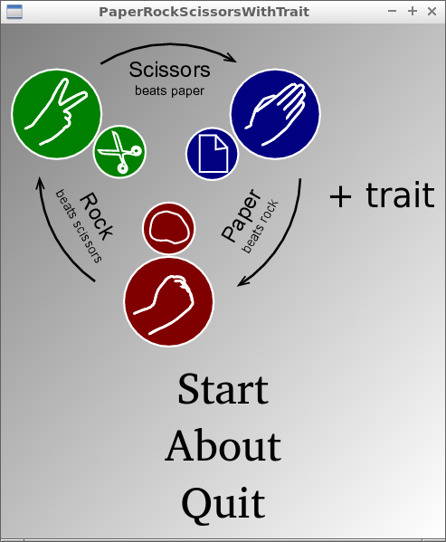
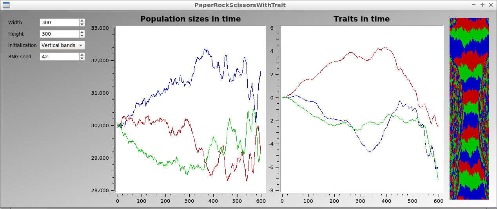

# PaperRockScissorsWithTrait

[Go to the nicely rendered website](https://richelbilderbeek.github.io/PaperRockScissorsWithTrait/).

C++ spatial paper-rock-scissors simulation in which a neutral trait co-evolves.

